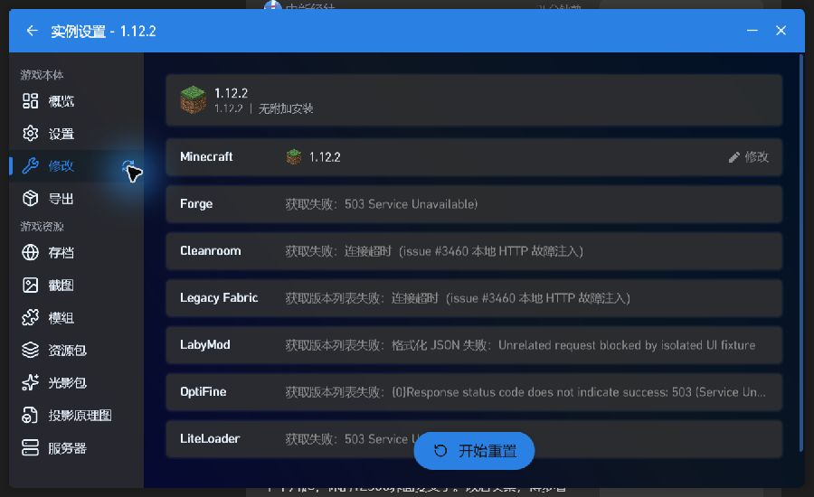
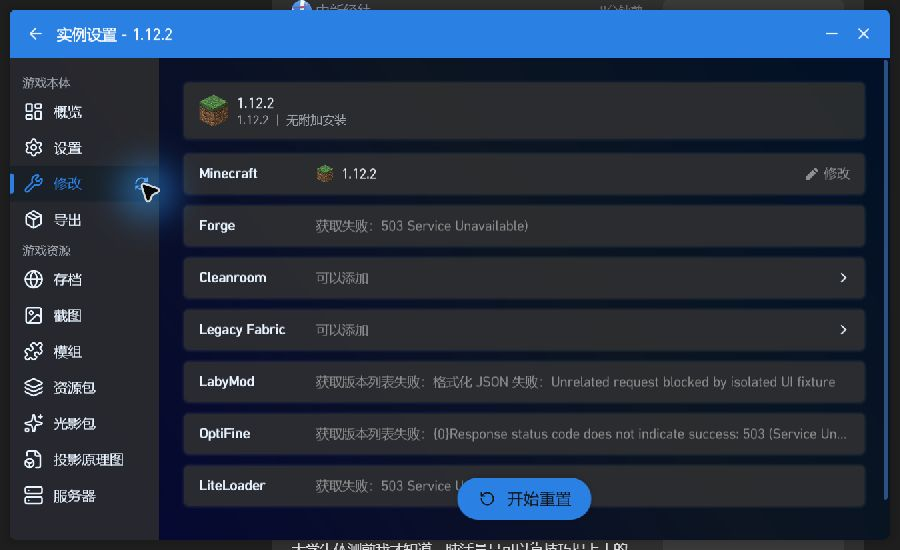
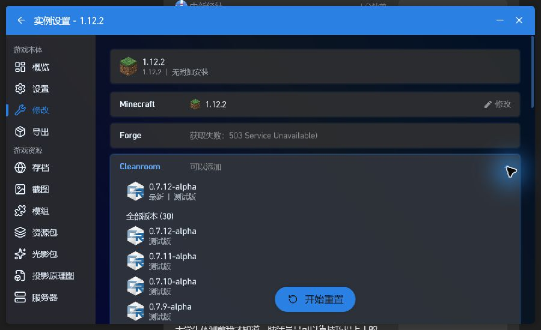
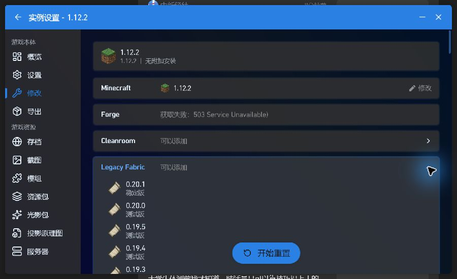
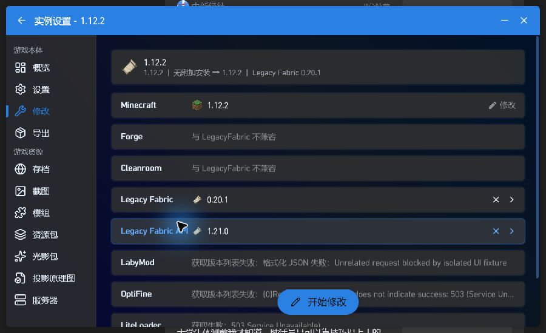
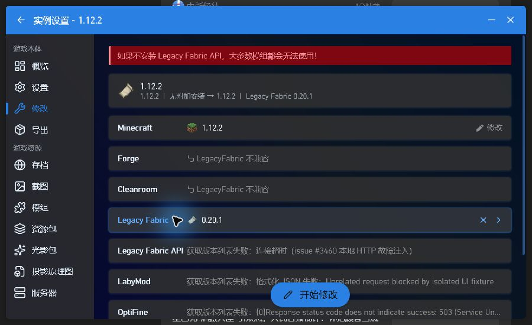
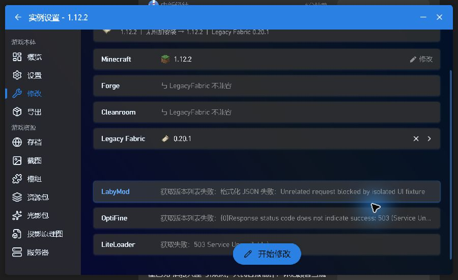

# Issue #3460：真实启动器界面复现与回归证据

验证日期：2026-10-23，Windows x64，.NET SDK 10.0.402 / Windows Desktop Runtime 10.0.13。

- 上游问题：[PCL-Community/PCL-CE#3460](https://github.com/PCL-Community/PCL-CE/issues/3460)
- 草稿修复：[PCL-Community/PCL-CE#3696](https://github.com/PCL-Community/PCL-CE/pull/3696)
- 原版源码：`8f0beaf9315597fdd4cf6171d7e1074e10171be9`
- 补丁源码：`bc8381a49c628f4686a03ae796aaa7088a494f13`

## 测试方法与范围

分别编译并运行完整 WPF 启动器，通过 Windows 界面自动化点击“实例设置 → 修改 → 侧栏刷新”，展开列表、选择 Legacy Fabric。没有直接调用页面刷新函数，也没有替换 LoaderTask、手动赋予加载器成功状态或修改生产源码。

诊断启动钩子只在测试进程内隔离共享配置/缓存路径、区分窗口身份，并将 HTTP 客户端替换为可控响应处理器。`fail` 模式对三个目标列表抛出 TimeoutException；`success` 模式返回事先从公开接口保存的 JSON。其他请求返回503，因此截图里其他加载器可能显示503；这些请求不属于本次验收。

实例夹具使用 Mojang 的1.12.2版本元数据，并加入 PCL 下载实例通常写入的 `clientVersion: 1.12.2` 字段。没有完整安装游戏的 JAR、资源及支持库，没有登录账号、启动 Minecraft，也没有点击“开始修改/开始重置”。

这是完整应用的界面自动化与进程内 HTTP 故障注入验证，不能代表真实第三方网络故障的端到端验收，也不替代人工功能验收或代码审核。首次启动的授权提示由操作者自行处理，配置和账号数据不包含在证据中。

## 观察结果

| 目标列表 | 原版：刷新前→后 HTTP 请求次数 | 补丁：刷新前→后 HTTP 请求次数 | 实际界面观察 |
| --- | --- | --- | --- |
| Cleanroom | 1→1 | 1→2 | 原版保留超时；补丁恢复“可以添加”，可展开30个版本 |
| Legacy Fabric | 1→1 | 1→2 | 原版保留超时；补丁可展开列表并选择0.20.1 |
| Legacy Fabric API | 8→8 | 8→9 | 补丁恢复后，选择 Legacy Fabric 会显示并自动选择 API 1.21.0 |

API 初始8次请求来自生产代码自身的重试及镜像回退，不是8次点击。补丁的第9次请求成功后，前置工程元数据请求也成功返回。

另开原版会话，仅令 API 请求失败（`api-fail`），先选择 Legacy Fabric，确认 API 的超时错误可见，再恢复响应、点击刷新。API 请求仍为8次，未产生重试。刷新会清除未应用的加载器选择；重新选择后，本次基线会话的 API 区域没有恢复可选版本，截图中表现为空白区域。没有将此截图描述为“刷新后错误文字仍可见”。

此前同一补丁的真实 LoaderTask 分支回归为36/36，覆盖12个列表的超时恢复、成功缓存后强制刷新、连续刷新。本轮完整应用重新构建：原版0错误/5381警告；补丁0错误/5376警告。核心套件原有47项基线失败仍保留披露，未将整套测试记为通过。

本轮另一次重跑该旧诊断工具时，首次运行触发了工具的5秒等待上限，未完成计数；未修改任何源码原样重跑为36通过、0失败。因此不宣称该诊断工具没有时间波动，也不将首次中断记为通过。完整应用界面结论另由截图和 HTTP 请求计数支持。

## 截图

原版，三个目标请求均失败后点击刷新，Cleanroom/Legacy Fabric 仍为超时：

补丁，执行相同刷新操作后两个列表恢复：

恢复后的实际 Cleanroom 列表：

恢复后的 Legacy Fabric 列表及 API 自动选择：

原版 API 单独失败会话，刷新前错误可见；恢复响应、刷新并重新选择 Legacy Fabric 后未恢复 API 版本：

所有截图均为实际测试窗口的原始抓图，没有修改图像内容。

## 复核与重现

1. 在补丁源码工作树中保存本目录，保持 `contribution-evidence/issue-3460/ui` 或 `output/issue-3460/ui` 的三层相对位置。安装.NET10 SDK，并先按仓库方式构建 Release x64 启动器，使原工程的 `bin/Release/net10.0-windows` 产物存在。
2. 可用 `PCL_TEST_DOTNET` 指定实际 `dotnet.exe`。运行 `pwsh -File ./prepare.ps1`，生成原版与补丁的隔离目录。首次下载的公开响应会保存在 `fixtures`；本目录附有本轮捕获的快照及来源。
3. 运行 `pwsh -File ./launch.ps1 -Variant baseline`；打开1.12.2实例设置的“修改”页，等待超时。将 `baseline/mode.txt` 改为 `success`，点击侧栏刷新，核对界面及 `baseline/requests.jsonl`。
4. 关闭原版，仅运行 `-Variant patched`，执行相同步骤。三个列表应再次请求，两个加载器列表恢复；选择 Legacy Fabric 后 API 应恢复。
5. 单独检查 API 时，在新进程启动前将对应模式设为 `api-fail`；选择 Legacy Fabric 使 API 错误可见，切换为 `success` 后刷新。每个模式都使用独立进程，避免成功结果的全局缓存影响初始失败场景。

`observations.json` 保存点击刷新前后的计数快照，`target-requests.jsonl` 只包含本轮被验证会话的目标公开接口请求，不包含其他请求或配置。`binary-hashes.json`、`artifact-hashes.json` 用于核对产物；`StartupHook.cs` 可检查具体故障注入边界。

## AI 使用说明

使用 OpenAI Codex（GPT-6）编写诊断工具、操作测试界面与整理证据。未宣称完成人工代码审核或人工功能验收。生产修复仍仅为 PR #3696 的三行 Start 调用，本证据目录只在 fork 的独立分支发布，不并入上游修复差异。
